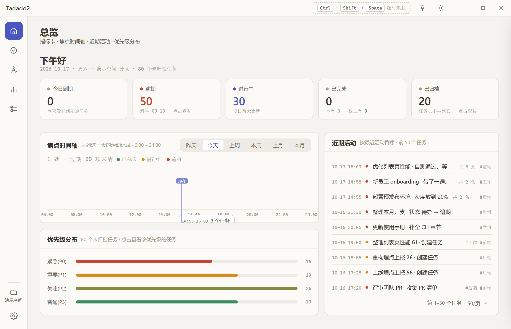
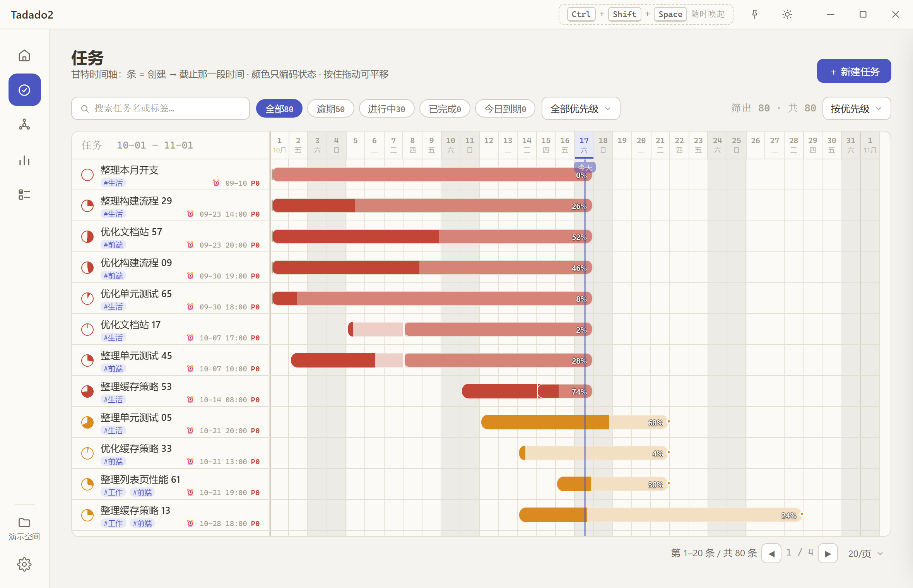
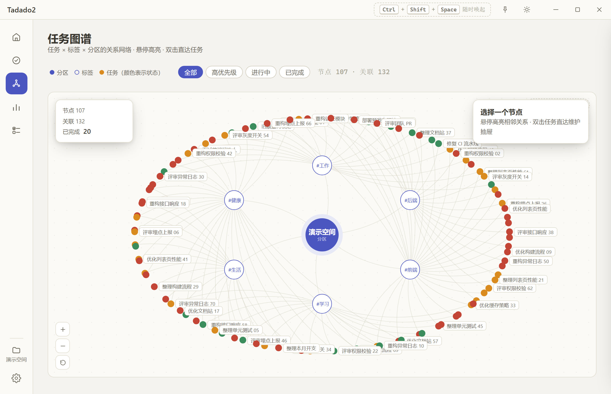
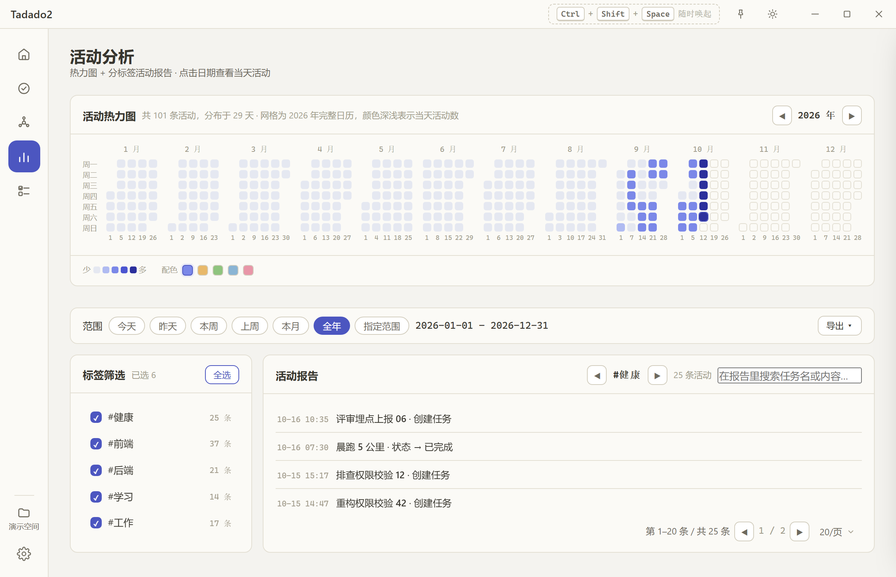
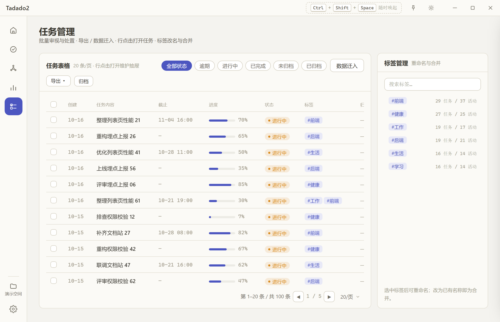
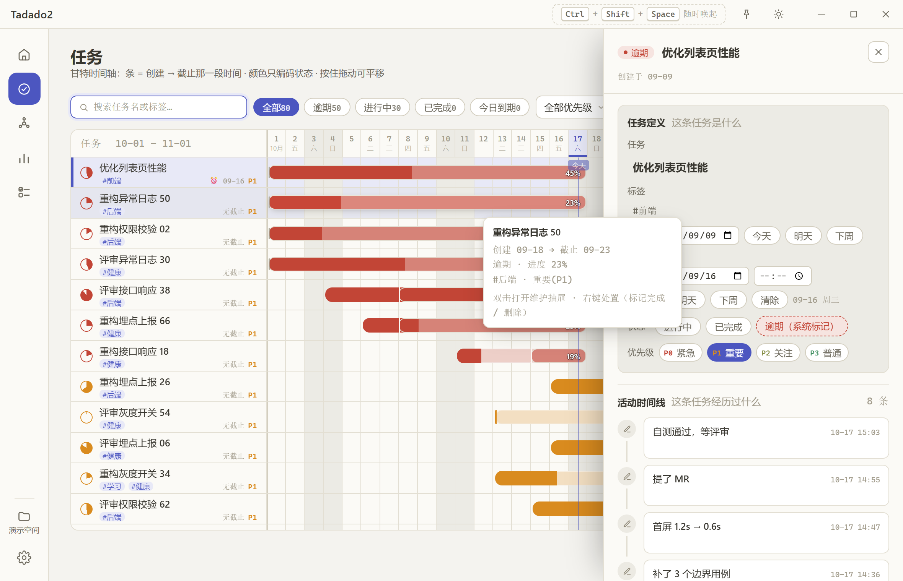
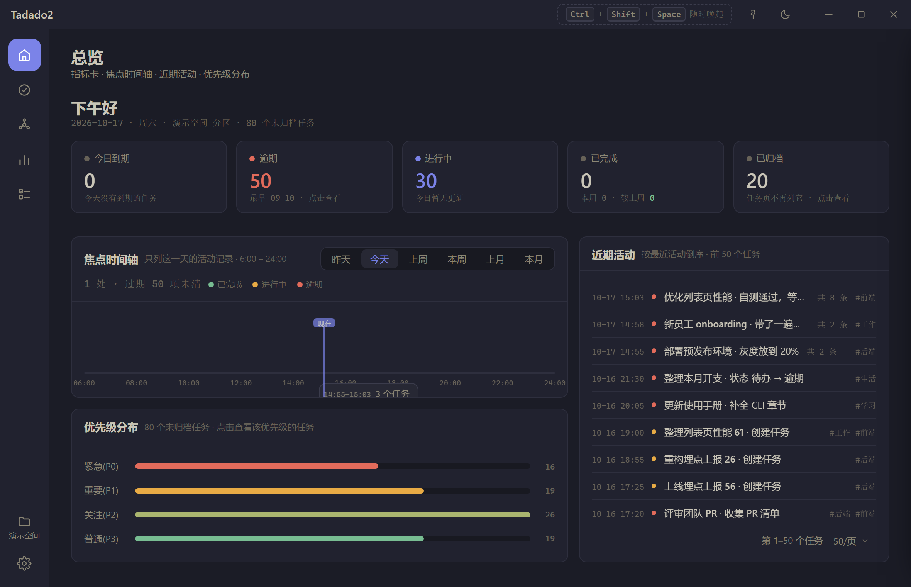

<p align="center">
  
</p>

<h1 align="center">Tadado2</h1>

<p align="center">
  <b>本地优先的任务管理器，为每条任务保留一条时间线。</b>
</p>

<p align="center">
  <a href="https://github.com/HananxR/Tadado/releases"></a>
  <a href="LICENSE"></a>
  
  
</p>

<p align="center">
  
</p>

## 项目简介

Tadado2 是面向 Windows 的本地优先桌面任务管理器。任务以状态、标签、截止日期与进度组织，
每次推进记录为该任务专属的活动时间线；界面同时呈现当前待办与一段时间内的推进记录。

数据保存于本机单个 SQLite 文件（`%APPDATA%\com.tadado.app\tadado.data`），不设账号、
不提供云端同步，也不包含订阅功能。应用以表单、甘特时间轴和维护抽屉呈现信息，
Markdown 仅作为数据交换格式使用，不参与存储与日常编辑，详见[设计说明](#设计说明)。

本项目面向单人本地使用：不提供同步、分享与协作，不提供移动端，发布产物仅面向 Windows。
当前主线为 v1.x（Tauri 2、TypeScript、SQLite），前代 v0.x（PySide6）已归档于
[`archive/pyversion`](https://github.com/HananxR/Tadado/tree/archive/pyversion) 分支；
两条版本线各自维护代码与文档，不共享数据，发版记录见 [CHANGELOG.md](CHANGELOG.md)。

## 特性

| 能力 | 说明 |
|---|---|
| 五个页面 | 总览、任务、任务图谱、活动分析、任务管理；`Ctrl+1` … `Ctrl+5` 直接切换 |
| 活动时间线 | 每条进展按时间归入所属任务；活动分析页提供整年热力图与分标签报告 |
| 甘特时间轴 | 任务页以创建至截止的色条呈现区间，颜色编码状态，进度由行首图标显示 |
| 本地存储与备份 | 数据集中于单个 SQLite 文件，备份与换机只需复制该文件；导出为供阅读的清单，不是备份格式 |
| 分区与口令 | 分区作为数据隔离边界，支持独立口令与空闲自动重锁；口令仅作界面遮蔽，不加密数据文件 |
| 隐私与权限 | 前端权限清单未授予网络访问；仅在主动检查更新时由原生更新插件访问 GitHub |
| 离线帮助 | 内置中文手册随程序分发，无脚本与外部资源，便携版单文件内亦可使用 |
| 应用内更新 | 安装版可在「设置 → 关于」下载并安装新版本，便携版需手动替换 |
| 运行时 | 基于 Tauri 2 与系统 WebView2，产物为单文件 exe，无需 Python、Node 或额外运行库 |
| 全局快捷键 | `Ctrl+Shift+Space` 唤起或收起主窗口，最小化时还原并聚焦 |

## 界面截图

顶部主视觉为总览页。下列各图展示其余四个页面及两类常驻界面元素。

|  |  |
|:--:|:--:|
| <br>**任务** | <br>**任务图谱** |
| <br>**活动分析** | <br>**任务管理** |
| <br>**维护抽屉** | <br>**暗色主题** |

维护抽屉为任务详情侧栏，暗色主题为同一套设计令牌的另一种取值，两者不属于五个页面。
五个页面均撑满窗口，页头、工具栏与分页器固定，列表与表格在卡片内部滚动。

## 安装

从 [GitHub Releases](https://github.com/HananxR/Tadado/releases) 获取最新版本（当前 **v1.0.6**）；历史版本同样在发布页可取。

| 形态 | 说明 |
|---|---|
| Windows 安装包 | `Tadado2_1.0.6_x64-setup.exe`（3.87 MB），双击安装 |
| MSI | `Tadado2_1.0.6_x64_en-US.msi`（5.11 MB），适用于静默或企业分发 |
| 便携版 | `Tadado2-portable.zip`（4.81 MB），解压即可运行，使用系统自带 WebView2 |
| 源码构建 | `cd desktop && npm install && npm run tauri dev` 可预览界面；正式打包还需签名私钥与更新清单，见 [`desktop/README.md`](desktop/README.md) 与[发布流程](resources/skill/tadado-release/SKILL.md) |

> **国内下载**：阿里云盘（国内推荐）<https://www.alipan.com/s/GHLF84V9n2L>，公开分享、无需提取码。
> 链接不可用时可改用 [GitHub Releases](https://github.com/HananxR/Tadado/releases)，或通过公众号 **Pyvan** 反馈。
> 目录中 `Tadado2_setup_v<版本>.exe` 为 v1.x 安装包；更早的 `Tadado_*` 属于
> v0.x（PySide6）历史包，已停止更新。网盘文件未签名，可使用
> `Get-FileHash <文件> -Algorithm SHA256` 与 Releases 上的同一文件核对 ——
> 当前版本安装包的 SHA256 为 `80F4B6E921C6E9153F8992E08C90FE5FDDEAEA43D77833321CD31CD00A54AEFD`。

首次运行可能触发 SmartScreen 提示；安装包未购买代码签名证书，选择「更多信息 → 仍要运行」即可。
应用首次启动会载入 100 条样例任务（位于「演示空间」分区），可在任务管理页批量删除，或新建分区后从零开始。
升级、卸载与数据保留策略见[内置帮助手册](desktop/src-tauri/resources/help/index.html)的「安装、升级、卸载」章节。

## 设计说明

Tadado2 与 Markdown 的关系可归纳为三个层面。

**概念来源。** 领域模型脱胎于「一行一条任务」的记法：状态、标签、截止与进度写在任务行内，
进展以缩进行附属于该任务。该记法在 v1.x 中与 v0.x（Py 版）存在分叉，两版写法不通用；
活动行的作用是让导出的清单保留完整的历史记录。

**当前角色。** 任务数据存储于 SQLite 文件，界面由表单、甘特时间轴与维护抽屉构成。
任务行记法仅用于数据交换：任务管理页的「数据迁入」读取清单后显示解析条数，并逐条列出
未能识别的行与同名任务，活动行随任务写入时间线。编辑抽屉中的「Markdown 源」区块自
v1.0.6 起从界面收起，日常操作不涉及 Markdown 文本的编辑。Markdown 既不是存储格式，
也不是界面编辑格式。

**导出格式。** 导出菜单中的 `.md` 属于另一种格式：按「标签 → 任务 → 活动」三层组织，
供阅读与存档，md、txt、xlsx 为同一份数据的不同呈现。该清单不携带状态与归档信息，
也不能用于恢复应用，与上述任务行记法互不通用。

### 任务行记法

```markdown
- [~] 示例任务 #项目 ⏰09-29 14:30 :: 80%
   - 09-25 16:50 记一条进展
```

| 写法 | 含义 |
|---|---|
| `[~]` `[x]` | 状态：进行中 / 已完成 |
| `[ ]` | 兼容写法，读入后视为进行中 |
| `#项目` | 标签；表单最多三个，迁入时不截断 |
| `⏰09-29 14:30` | 截止；省略表示无截止 |
| `:: 80%` | 进度 |
| 缩进在下一行 | 活动记录，归入所属任务的时间线 |
| 行尾 `+1w` | 旧版循环标记，字段已移除，解析时跳过 |

完整定义见 [`DESIGN.md`](DESIGN.md) §4.8（Markdown 写法）与 §4.9（导出），
数据层与交付口径见 §3、§7。从 v0.x 迁移旧数据的转换流程见
[迁移工具与操作手册](resources/skill/tadado-activity-import/SKILL.md)。

## 文档

**使用与维护**：[内置帮助手册](desktop/src-tauri/resources/help/index.html) 随程序离线分发（中文），包含下列章节。

| 主题 | 手册章节 |
|---|---|
| 界面与快捷键 | 界面总览 → 快捷键、每个页面回答什么 |
| 五个页面详解 | 总览页 / 任务页 / 任务图谱 / 活动分析 / 任务管理 |
| 数据与备份 | 数据在哪里 / 数据与备份 |
| 分区、口令与归档 | 分区与归档 → 分区、口令锁（隐私屏风） |
| 安装、升级、卸载 | 安装、升级、卸载 → 升级、卸载、系统要求 |
| 检查更新 | 设置 → 检查更新怎么工作 |
| 数据迁入 | 任务管理 → 数据迁入 |

**项目文档**：

- 详细设计：[DESIGN.md](DESIGN.md)（§3 数据层、§4.8 Markdown 写法、§4.9 导出、§7 迁移与交付）
- 更新日志：[CHANGELOG.md](CHANGELOG.md)（最新一条 v1.0.6，2026-11-10）
- 安全策略：[SECURITY.md](SECURITY.md)；权限清单：[`desktop/src-tauri/capabilities/default.json`](desktop/src-tauri/capabilities/default.json)
- 桌面端开发：[`desktop/README.md`](desktop/README.md)
- 从 v0.x 迁移旧数据（仅老用户需要）：[迁移工具与操作手册](resources/skill/tadado-activity-import/SKILL.md)
- 发布流程：[`resources/skill/tadado-release/SKILL.md`](resources/skill/tadado-release/SKILL.md)
- 国内渠道上传：[`resources/skill/tadado-aliyun/SKILL.md`](resources/skill/tadado-aliyun/SKILL.md)
- 参与贡献：[CONTRIBUTING.md](CONTRIBUTING.md) · 行为准则：[CODE_OF_CONDUCT.md](CODE_OF_CONDUCT.md) · 许可：[LICENSE](LICENSE)

## 许可

[MIT License](LICENSE) © HananxR
